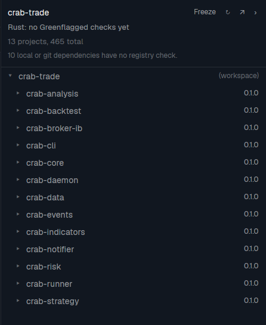
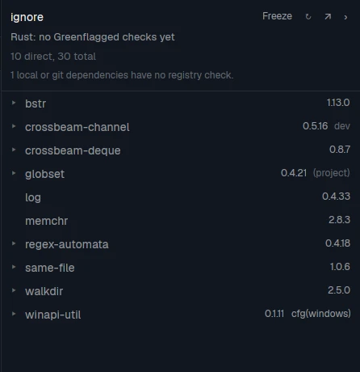
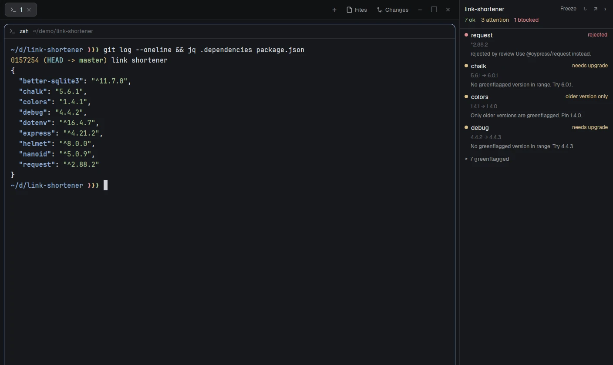
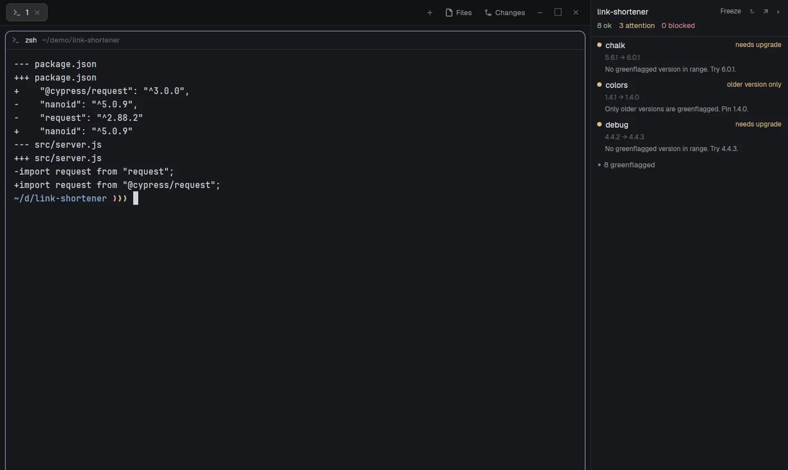
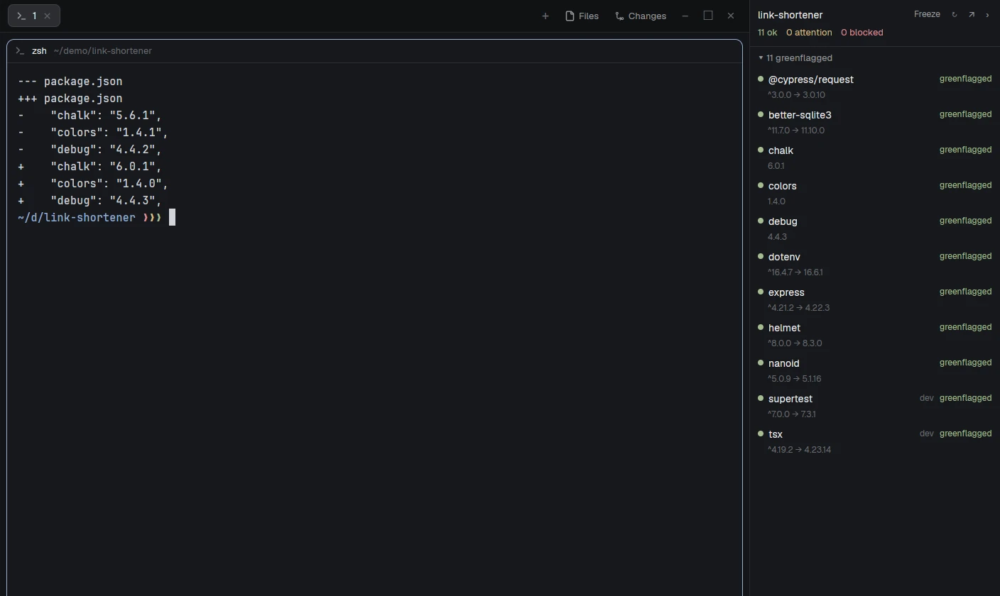

# Greenflagged for Herdr

A dependency tree viewer for [Herdr](https://herdr.dev). The panel follows the terminal you're
working in, finds the project's manifest, and shows its dependencies as a tree you open row by row:
npm, Python, Rust, Go, Java and Kotlin. It needs no account.

Sign in to [Greenflagged](https://greenflagged.dev) and an npm project gets checks on top: each
direct dependency's verdict, problems first, with the greenflagged packages folded behind a count.

What it does depends on the project's language:

| Language | What the panel shows | Read from |
|---|---|---|
| JavaScript (npm) | Its direct dependencies; signed in, each one's Greenflagged verdict | `package.json` |
| Python | A plain dependency tree, not checked | `pyproject.toml` or `requirements.txt`, with `uv.lock` or `poetry.lock` |
| Rust | A plain dependency tree, not checked | `Cargo.toml` and `Cargo.lock` |
| Go | Its direct modules, then its indirect ones in a group, not checked | `go.mod` alone |
| Java and Kotlin | Its direct dependencies, not checked | `pom.xml` or the Gradle build file, with `gradle.lockfile` when there is one |

Only npm gets verdicts, and only once you sign in. Without a token an npm project shows its direct
dependencies as a plain tree, with a "Sign in for Greenflagged checks" link above it. For the other
languages the panel sends nothing: there are no dots, the header says "no Greenflagged checks yet",
and you get the tree to browse. A Cargo workspace shows as
the workspace with its crates under it, and a crate's folder inside one shows that crate with its
sibling crates as expandable `(project)` rows, read from the workspace's `Cargo.lock`. Maven and
Gradle are read without running either. Python verdicts follow once Greenflagged's PyPI audit is
live.

## What it looks like

At the root of a Rust workspace, the panel shows the workspace with its crates under it:



In one crate of that workspace, with two sibling crates open:



An npm project before you sign in shows its direct dependencies the same way, with the sign-in link
above them:


### With Greenflagged checks

Signed in, the same npm panel checks every direct dependency. Here it opens on a project with one
blocked dependency and suggests a replacement for it:



Swapping `request` for `@cypress/request` clears the block, and the panel updates by itself:



Moving the other three to the suggested versions greenflags every dependency:



## Install

Ask your agent to add `github.com/greenflagged/herdr-greenflagged`, or copy the folder yourself:

```sh
git clone https://github.com/greenflagged/herdr-greenflagged
cp -R herdr-greenflagged/mods/greenflagged ~/.config/herdr-app/mods/
herdr-app check ~/.config/herdr-app/mods/greenflagged
```

It docks on the right the first time Herdr sees it. Install it on the machine that runs the Herdr
window, even if your projects are on another one.

## Update

Herdr doesn't update mods. To update this one, pull the repo and replace the folder:

```sh
git -C herdr-greenflagged pull
rm -rf ~/.config/herdr-app/mods/greenflagged
cp -R herdr-greenflagged/mods/greenflagged ~/.config/herdr-app/mods/
```

## Sign in (optional)

The tree needs no account. Signing in adds Greenflagged's verdicts to npm projects.

New to Greenflagged? Create a free account at <https://greenflagged.dev/login>, or use the link in
the panel. `npm login` opens the same page, so you can also sign up as part of signing in.

The checks need a Greenflagged token. The quickest way is the **Sign in for Greenflagged checks** link
in the panel's header, which opens a tab running `npm login`, picks up the token when you finish, and
switches the panel to the checked view. Or run it yourself, then click ↻:

```sh
npm login --registry=https://greenflagged.dev/npm/
```

This saves the token in `~/.npmrc`. It doesn't change where npm installs from.

You can also mint a token at <https://greenflagged.dev/account/tokens> and export it from your shell
profile. `GREENFLAGGED_TOKEN` wins over `~/.npmrc`:

```sh
export GREENFLAGGED_TOKEN=gflag_...
```

If the focused terminal is on another machine, the panel looks for a token on the machine running
Herdr first, then on that one, so you only need to sign in on one of them.

## What it does on your machine

- **Network:** it sends the name and version range of each direct dependency to
  `https://greenflagged.dev/mcp`, with your token. That includes the names of private packages.
  It sends nothing else from your project. Without a token it sends nothing for npm either, and
  for Python, Rust, Go, Java and Kotlin it sends nothing at all: the tree is built from the files
  below, on your machine.
- **Requests:** hovering a `not imported` package shows a Request button. Clicking it asks Greenflagged
  to import and review that package, under your token. Nothing is requested unless you click.
- **Files:** it reads `package.json` from your terminal's folder and the folders above it, looks for
  `pyproject.toml`, `requirements.txt`, `Cargo.toml`, `go.mod`, `pom.xml`, `build.gradle.kts` and
  `build.gradle` there too, `uv.lock` and `poetry.lock` beside a Python manifest, `Cargo.lock` at the
  root of a Rust project's workspace (beside the manifest for a crate outside any), and
  `gradle.lockfile` beside a Gradle build file. In a Rust workspace it also reads the root's
  `Cargo.toml` and every member crate's, up to 256. A member path may point outside the project
  (`../x` or an absolute path), as Cargo allows, and that `Cargo.toml` is still read. For a Gradle
  build it also looks for `settings.gradle.kts` or `settings.gradle` in the build file's folder and
  the folders above it, stopping before your home folder (home is checked only when the build file
  itself is there), and reads `gradle/libs.versions.toml`, `build.gradle.kts` and `build.gradle` from
  the first folder that has one. At that root it also reads `build.gradle.kts` or `build.gradle` from
  each module folder the settings file includes (up to 100), only plain folder names under the root,
  never `..`. It reads `~/.npmrc`. It writes nothing to your project. Requests are remembered in
  Herdr's `shared.json`.
- **Programs:** it runs `printenv` to read your token, `xdg-open` or `open` when you click a row,
  `find` to list a Cargo workspace's member folders, and `npm login` when you click the sign-in link.

## When it checks

Signed in, it checks an npm project when you focus a different project, when the dependencies in
`package.json` change, and every 15 minutes while it's open. Going back to a project within 5 minutes
reuses its last result, and ↻ always checks again.

Click **›** to collapse the panel to a narrow rail showing its counts, and **‹** to expand it. Click **↗**
to detach it into a floating window you can drag anywhere, and **↙** to dock it again.

Click **Freeze** to keep the panel on the current project while you work in another tab. It keeps
updating for that project. Click **Frozen** to follow the focused terminal again. Transitive dependencies aren't checked. Dependencies that come
from a path or a git URL aren't checked either, and the panel counts them.

## Credits

The rail's label in `label.svg` is drawn from outlines of [Geist](https://github.com/vercel/geist-font),
under the SIL Open Font License 1.1.

## Develop

```sh
npm test
```

`audit.js` holds the logic and imports nothing from Herdr, so the tests run under plain Node. So do
`tree.js` (the plain dependency tree), `python.js` (Python's manifests and lockfiles), `cargo.js`
(Rust's), `go.js` (Go's `go.mod`), `maven.js` (Maven's `pom.xml`), `gradle.js` (Gradle build files,
settings, version catalogs and `gradle.lockfile`), `xml.js`, the XML reader, and `toml.js`, the TOML
reader, whose tests use a vendored copy of the [toml-test](https://github.com/toml-lang/toml-test)
suite in `test/fixtures/toml-test/`.
