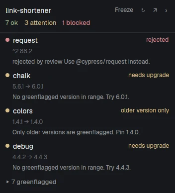

# Greenflagged

A panel on the right of the window that shows how the project in the focused terminal stands against
the Greenflagged registry: a count of ok, attention and blocked dependencies, then the problems, worst
first, with the greenflagged packages folded behind a count.

## What you see

Top to bottom, 320 px wide, on theme `surface`:

- **Header**, 10 px side padding, 1 px `border` line below: the project's `name` from `package.json`
  (13 px semibold `foreground`, or "Dependencies" with no project) and a ↻ at the right (12 px `dim`).
- **Counts**, 12 px: `N ok` in `ansi2`, `N attention` in `ansi3`, `N blocked` in `ansi1`.
- **Notes**, 11 px, only when they apply: dependencies past the 500 cap, the number of local or git
  dependencies not checked, and the last error while older results stay on screen.
- **Rows**, scrolling. Each has a 7 px dot in its level's color, the package name, a `dev` tag for dev
  dependencies and a status label; below that, the constraint and `→ version`; below that, a reason if
  there is one.
- **`▸ N greenflagged`**: a row that unfolds the ok packages.

## How it behaves

Levels and labels come from the audit `status`:

| Level | Labels |
|---|---|
| blocked (`ansi1`) | `rejected`, `uninstallable`, `not on npm` |
| attention (`ansi3`) | `needs overrides`, `in review`, `not imported`, `deprecated`, `needs upgrade`, `older version only`, `can't check` |
| ok (`ansi2`) | `greenflagged` |

- `deprecated` is `greenflagged` with a null `version`. `needs upgrade` is `greenflagged` with a
  `proposed_constraint`, and `older version only` is the same when `version` is below the constraint.
- `can't check` is `rejected` with the detail `unparseable constraint`, as a dist-tag like `next` gets.
- A rejected row adds the first `remediation`: "Use X instead." or "Fixed in X."
- It follows the focused terminal. Focusing a mod pane, including this panel, keeps the last project.
- It looks for `package.json` in the terminal's folder and upward, stopping at home.
- It audits on ↻, every 15 minutes, and when a project or its dependencies change, unless that exact
  project and dependency list was audited in the last 5 minutes. Saving with the same dependencies or
  flipping back to a recent project sends no request.
- Freeze, 11 px in the header left of ↻, keeps the panel on its project: focus changes are ignored, while
  audits, watching, links and Request carry on. It reads `Frozen` in `accent` until clicked again, and then
  the panel returns to the focused terminal. It lasts as long as the panel copy.
- Agent status doesn't change the panel; it reacts to focus, so it covers agent and plain terminals alike.
- Hovering a `not imported` row swaps its label for a Request button (`solid` on `solid_foreground`, 11 px).
  Clicking shows "Requesting…", then `requested` for good. A registry answer of `not_in_upstream` makes the
  row a red `not on npm`. A failed call shows its error in `ansi1` under the row and can be retried.
- Clicking any row opens `https://greenflagged.dev/packages/npm/<name>` in the browser; rows highlight with
  `hover`. Clicking Request doesn't open it.
- With no token, it shows `npm login --registry=https://greenflagged.dev/npm/` and the tokens page, and
  sends no request. A 401 or 403 adds "Greenflagged refused the token."
- ↻ forgets the token, so a new sign-in takes effect without a restart.

## Built from

- `mod.json`: `{ "place": "right", "size": 320 }`. No layout, no keys.
- `audit.js`: pure logic with no Herdr imports. `ECOSYSTEMS` maps a manifest filename to a parser.
- `main.js`: the `View`. From `herdr`: `spaces`, `panes`, `focused`, `exec`, `home`, `readTextFile`,
  `watchFolder`, `theme`. It runs `printenv`, and `xdg-open` then `open` for links.
- The audit is one JSON-RPC `tools/call` of `audit_manifest` by `POST https://greenflagged.dev/mcp` with
  `Authorization: Bearer <token>`. The endpoint is stateless, so there is no `initialize`. The answer
  arrives as JSON or as one SSE event, and the result is JSON text in `result.content[0].text`, keyed by
  package name.
- Request is one `tools/call` of `request_package`, with `version` only when the manifest pins an exact one.
  Outcomes are kept per package name in shared state `greenflagged.requested`, and `already_greenflagged`
  isn't kept, it re-audits instead.
- The token comes from `GREENFLAGGED_TOKEN`, else the `_authToken` line of `~/.npmrc` for
  `//greenflagged.dev/npm/` or `//npm.greenflagged.dev/`, which may be a literal or `${VAR}`.
  `npm login --registry=https://greenflagged.dev/npm/` writes that line. It looks on the machine running
  the window first, then on the focused space's machine, using `exec` and `readTextFile` with `on`.

## Watch out

- `fetch` in a mod returns `{ status, url, ok, text(), json() }` and no response headers.
- `audit_manifest` is capped at 500 entries and lists direct dependencies only.
- npm aliases (`"x": "npm:lodash@^4"`) must be audited under the real package name.
- A pattern for local paths must not match tilde ranges. `~1.2.3` is a registry range and `~/pkg` is a
  path. Getting this wrong hides most of an Angular project behind a clean result.
- `older version only` must recommend an exact pin, never `proposed_constraint`: `^1.5.1` allows the newer
  versions that weren't approved, and on public npm those can be the compromised ones.
- The Request button must call `cx.stop_propagation()`, or its click reaches the row and opens the browser.
- Guard a request twice: an in-flight set for double clicks, and shared state after it finishes. Only apply
  remembered outcomes to rows still `not_imported`, so the audit wins once the package is imported.
- `home()` is the window's machine. On a remote machine, ask for `HOME` there.
- Don't filter `watchFolder` events to one exact path, and don't re-audit on every event. `npm install`
  fires many, so compare the dependencies before sending anything.
- Key the audit cache on machine, path and dependencies together: the same path can exist on two machines.
- `watchFolder` is local only. On a remote space the panel still reads the manifest there, and picks up
  changes on the timer or ↻.
- Never put the token in `localStorage` or draw it.
- Never call `resolve_dep_tree` for this: it queues imports unless `autoRequest` is false.

## Done when

- `npm test` passes and `herdr-app check` passes.
- In a project with `request` at `^2.88.0`, focusing its terminal shows a red `rejected` row.
- In a project with `event-stream` at `3.3.6`, that package shows `needs upgrade`.
- A dependency at `~5.4.3` is audited, not counted as local.
- With the token only on the project's machine, the panel still signs in.
- Focusing a terminal in another project switches the panel, and clicking the panel doesn't.
- Adding a dependency to `package.json` adds a row after saving.
- Flipping between two projects inside 5 minutes sends one audit for each, not one per switch.
- With Freeze on, focusing another project changes nothing, and turning it off switches to that project.
- Requesting a `not imported` package leaves it `requested` after a restart, with no Request button.
- Clicking a row opens its package page, and clicking Request doesn't.
- With no token, the panel shows the setup text and sends no request.
- A folder with no `package.json` shows "No package.json in this folder or above it."
