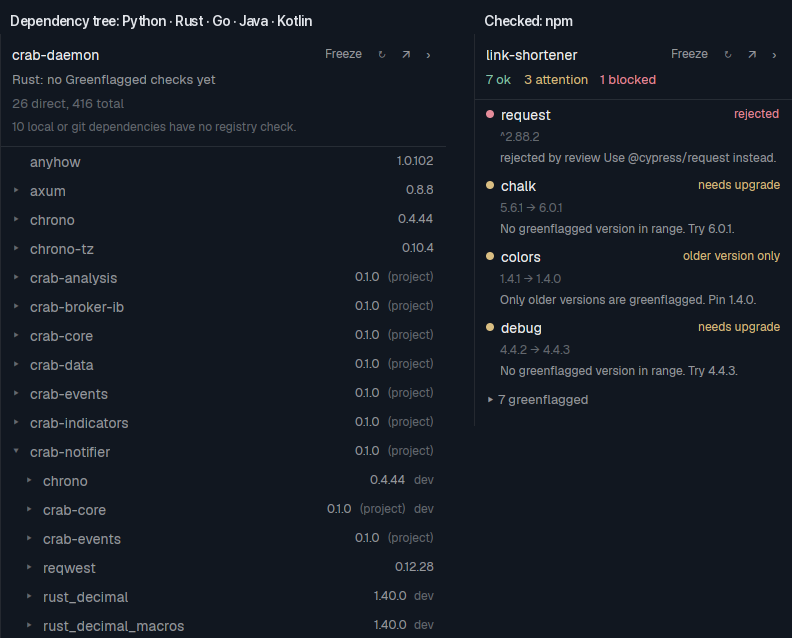

# Greenflagged

Spot rejected and unreviewed npm dependencies as your agent works, and see what to use instead. [Greenflagged](https://greenflagged.dev) is a private npm registry that scans and reviews every package it serves. It is free for personal use.

## What you see

Top to bottom, 320 px wide, on theme `surface`:

- **Header**, 10 px side padding, 1 px `border` line below: the project's `name` from `package.json`
  (13 px semibold `foreground`, or "Dependencies" with no project) and a ↻ at the right (12 px `dim`).
- **Counts**, 12 px: `N ok` in `ansi2`, `N attention` in `ansi3`, `N blocked` in `ansi1`.
- **Notes**, 11 px, only when they apply: dependencies past the 500 cap, the number of local or git
  dependencies not checked, and the last error while older results stay on screen.
- **Rows**, scrolling. Each has a 7 px dot in its level's color, the package name, a `dev` tag for dev
  dependencies and a status label; below that, the constraint and `→ version`; below that, a reason if
  there is one.
- **`▸ N greenflagged`**: a row that unfolds the ok packages.

## How it behaves

Levels and labels come from the audit `status`:

| Level | Labels |
|---|---|
| blocked (`ansi1`) | `rejected`, `uninstallable`, `not on npm` |
| attention (`ansi3`) | `needs overrides`, `in review`, `not imported`, `deprecated`, `needs upgrade`, `older version only`, `can't check` |
| ok (`ansi2`) | `greenflagged` |

- `deprecated` is `greenflagged` with a null `version`. `needs upgrade` is `greenflagged` with a
  `proposed_constraint`, and `older version only` is the same when `version` is below the constraint.
- `can't check` is `rejected` with the detail `unparseable constraint`, as a dist-tag like `next` gets.
- A rejected row adds the first `remediation`: "Use X instead." or "Fixed in X."
- It follows the focused terminal. Focusing a mod pane, including this panel, keeps the last project.
- It looks for `package.json` in the terminal's folder and upward, stopping at home. It also looks for
  `pyproject.toml`, `requirements.txt` (Python), `Cargo.toml` (Rust) and `go.mod` (Go), which it can't
  audit yet. The nearest folder with any of them wins, and within one folder `package.json` wins.
  When the winner can't be audited, it sends no request. A Python project shows a plain tree of its
  dependencies, read from `uv.lock` or `poetry.lock` beside the manifest when there is one; Rust and Go
  say "Greenflagged doesn't check <Language> dependencies yet." A `pyproject.toml` with no dependency
  tables at all (`dynamic = ["dependencies"]`) gives way to a `requirements.txt` beside it.
- It audits on ↻, every 15 minutes, and when a project or its dependencies change, unless that exact
  project and dependency list was audited in the last 5 minutes. Saving with the same dependencies or
  flipping back to a recent project sends no request.
- `›` collapses the docked panel to a 40 px rail: `‹`, the blocked, attention and ok counts stacked in
  their colors, then "Dependencies" reading top to bottom in `muted`, which also expands it. Below 120 px wide it draws the rail however it got there, and `‹` restores the last width.
- `↗` detaches it into a 340×600 window: a key `greenflagged`, kept across restarts, that stays where dropped
  and keeps Freeze and its project. The docked block hides. `↙` in the window docks it again. Dragging
  anywhere but a control moves the window.
- Freeze, 11 px in the header left of ↻, keeps the panel on its project: focus changes are ignored, while
  audits, watching, links and Request carry on. It reads `Frozen` in `accent` until clicked again, and then
  the panel returns to the focused terminal. It lasts as long as the panel copy.
- Agent status doesn't change the panel; it reacts to focus, so it covers agent and plain terminals alike.
- Hovering a `not imported` row swaps its label for a Request button (`solid` on `solid_foreground`, 11 px).
  Clicking shows "Requesting…", then `requested` for good. A registry answer of `not_in_upstream` makes the
  row a red `not on npm`. A failed call shows its error in `ansi1` under the row and can be retried.
- Clicking any row opens `https://greenflagged.dev/packages/npm/<name>` in the browser; rows highlight with
  `hover`. Clicking Request doesn't open it.
- With no token, it sends no request and shows a sign-in screen, 14 px side padding: "Check your dependencies"
  (14 px semibold), one line of `muted` text, a full-width 32 px **Sign in with npm** button (`accent` on
  `accent_foreground`, centered), and "New here? Create a free account", centered. A 1 px `border` line
  follows, then a folded "▸ Other ways to sign in" holding the `npm login` command in a `raised` code block and
  a link to the tokens page. A 401 or 403 adds "Greenflagged refused the token." in `ansi1`.
- The account link opens `https://greenflagged.dev/login`, which both signs in and creates accounts.
- The button opens a tab named "Greenflagged sign in" running that command in the project's folder, and
  the button becomes a native `.frames` spinner with "Waiting for you to sign in…". It looks for a token every 3 seconds for up to 5 minutes,
  then audits by itself as soon as one appears.
- ↻ forgets the token, so a new sign-in takes effect without a restart.

## Built from

- `mod.json`: `{ "place": "right", "size": 320 }`. No layout, no keys. The block is found by walking `layout()`
  for `content.mod`; without one (a mod pane), `›`, `↗` and `↙` aren't drawn.
- Collapse is `layout.resize {id, px}`, detach is `openOverlay {kind: "window"}` plus `layout.hide {id}`, and
  reattach is `layout.show {id}` plus `closeOverlay`. Shared state holds `greenflagged.width` and
  `greenflagged.detached`.
- `audit.js`: pure logic with no Herdr imports. `ECOSYSTEMS` maps a manifest filename to a parser.
- `toml.js`: a small TOML reader, also pure logic, for the Python and Rust manifests and lockfiles. One linear
  pass with no regex and a 1 MiB input cap, because issue #7 reports that Herdr interrupts a synchronous step
  after about a second. The cap bounds the work but doesn't guarantee a parse fits that budget. Duplicate keys
  and redefined tables are errors. Floats and date-times come back as raw strings. A bare value that isn't
  shaped like a boolean, integer, float or date-time is an error; date and time ranges aren't checked. Its
  tests run the valid cases of `toml-test`, vendored in `test/fixtures/toml-test/`.
- `tree.js`: pure logic, the plain dependency tree for a language Greenflagged can't check. A language gets one
  by adding `parse` and `lockfiles` to its `ECOSYSTEMS` entry; Python's are the first. Rows are name and
  version in `muted` with no dots, expanded one level at a time, with an environment marker as a small
  truncated `muted` tag when the lock has one. A shared package expands under each parent,
  a package already on its own path shows "(cycle)", and "N direct, M total" counts each package once. `dev`
  marks a package reachable only through dev dependencies. A resolver that skips the count walk
  (`count: false`) can't tell, so then `dev` marks only the direct dependencies the manifest lists as dev.
  Walks stop at a hard ceiling (`MAX_WALK_VISITS`, `MAX_WALK_POPS`). A lockfile over 16 MB isn't read, and
  a TOML lockfile is parsed without its wheel-hash lines, after which it must be under 1 MiB. It also
  exports `graphResolver` (a lock's package list to `resolve`) and `mergeDirect` (a lock's own record of
  the project's directs, joined with the manifest's) for each language to reuse.
- `python.js`: pure logic, Python's half of the tree: `pyproject.toml` (PEP 621, dependency groups,
  poetry) and `requirements.txt` parsers, and `uv.lock` / `poetry.lock` read into package lists.
  Measured 2026-11-01 under Node 26.3.0 (mean of 20 runs, on a local `uv init` project that isn't in
  the repo): its 29-package `uv.lock` (118 KB, 9 KB once its wheel lines are dropped) takes 0.14 ms to
  strip and parse, against 0.47 ms to parse raw. A synthetic 290-package lock (that lock's packages
  copied ten times under new names, 1.18 MB raw and 91 KB stripped) takes 1.25 ms, against 5.0 ms raw.
  At #7's estimated ~1000× for Herdr that is ~0.1 s and ~1.3 s. Its header lists the Python edge
  cases.
- `main.js`: the `View`. From `herdr`: `spaces`, `panes`, `focused`, `exec`, `home`, `readTextFile`,
  `watchFolder`, `theme`. It runs `printenv`, `xdg-open` then `open` for links, and
  `npm login` through `run("tab.new", { name, argv, folder })`.
- The audit is one JSON-RPC `tools/call` of `audit_manifest` by `POST https://greenflagged.dev/mcp` with
  `Authorization: Bearer <token>`. The endpoint is stateless, so there is no `initialize`. The answer
  arrives as JSON or as one SSE event, and the result is JSON text in `result.content[0].text`, keyed by
  package name.
- Request is one `tools/call` of `request_package`, with `version` only when the manifest pins an exact one.
  Outcomes are kept per package name in shared state `greenflagged.requested`, and `already_greenflagged`
  isn't kept, it re-audits instead.
- The token comes from `GREENFLAGGED_TOKEN`, else the `_authToken` line of `~/.npmrc` for
  `//greenflagged.dev/npm/` or `//npm.greenflagged.dev/`, which may be a literal or `${VAR}`.
  `npm login --registry=https://greenflagged.dev/npm/` writes that line. It looks on the machine running
  the window first, then on the focused space's machine, using `exec` and `readTextFile` with `on`.

## Watch out

- A direct dependency uv splits by environment marker is one row per locked version, each counted as a
  direct (numpy behind four `python_full_version` markers is four rows).
- The Python edge cases (markers on merged rows, poetry's double locks, uv workspaces) are listed in
  `python.js`'s header.
- `fetch` in a mod returns `{ status, url, ok, text(), json() }` and no response headers.
- `audit_manifest` is capped at 500 entries and lists direct dependencies only.
- npm aliases (`"x": "npm:lodash@^4"`) must be audited under the real package name.
- A pattern for local paths must not match tilde ranges. `~1.2.3` is a registry range and `~/pkg` is a
  path. Getting this wrong hides most of an Angular project behind a clean result.
- `older version only` must recommend an exact pin, never `proposed_constraint`: `^1.5.1` allows the newer
  versions that weren't approved, and on public npm those can be the compromised ones.
- The Request button must call `cx.stop_propagation()`, or its click reaches the row and opens the browser.
- Poll for a sign-in only after the button is clicked, and never overlap polls. `watchFolder` can't see a
  remote machine, and `~/.npmrc` may be on one.
- Leave `folder` out of `tab.new` while frozen: the current space may be on another machine.
- Read `overlay` and the window's own props from `props()`. `init`'s first argument doesn't carry them, and
  without `overlay` the window takes itself for the docked copy.
- Every control in a detached window needs `.on_mouse_down("left", ...)` calling `cx.stop_propagation()`, or
  pressing it drags the window.
- A hidden block's copy stays alive with its timers running. Skip its audits while detached, or each project
  is polled twice. ↻ must still work there, so a stuck flag can be recovered.
- GPUI can't rotate text. The rail's label is `label.svg`, "Dependencies" in Geist at 12 px as outlines
  rotated 90° clockwise, 14 px wide. Its path names the mod folder, so a rename has to change it too.
- Guard a request twice: an in-flight set for double clicks, and shared state after it finishes. Only apply
  remembered outcomes to rows still `not_imported`, so the audit wins once the package is imported.
- `home()` is the window's machine. On a remote machine, ask for `HOME` there.
- Don't filter `watchFolder` events to one exact path, and don't re-audit on every event. `npm install`
  fires many, so compare the dependencies before sending anything.
- Key the audit cache on machine, path and dependencies together: the same path can exist on two machines.
- `watchFolder` is local only. On a remote space the panel still reads the manifest there, and picks up
  changes on the timer or ↻.
- Never put the token in `localStorage` or draw it.
- Never call `resolve_dep_tree` for this: it queues imports unless `autoRequest` is false.

## Done when

- `npm test` passes and `herdr-app check` passes.
- In a project with `request` at `^2.88.0`, focusing its terminal shows a red `rejected` row.
- In a project with `event-stream` at `3.3.6`, that package shows `needs upgrade`.
- A dependency at `~5.4.3` is audited, not counted as local.
- With the token only on the project's machine, the panel still signs in.
- Focusing a terminal in another project switches the panel, and clicking the panel doesn't.
- Adding a dependency to `package.json` adds a row after saving.
- In a `uv init` project with `httpx[http2]`, `numpy` and a dev `pytest`, locked with
  `requires-python >= 3.9`, the panel shows "7 direct, 28 total": `numpy` four times with its marker as
  a tag, both `pytest` rows tagged `dev`, and `httpx` expanding to `h2` with markers. With `uv.lock`
  deleted and ↻ clicked, it shows the no-lockfile note and the three manifest dependencies.
- Flipping between two projects inside 5 minutes sends one audit for each, not one per switch.
- `›` gives a rail with the right counts, and `‹` restores the width, including after a restart.
- `↗` opens a window that survives a restart, on the same project if frozen, and `↙` brings the panel back.
- With Freeze on, focusing another project changes nothing, and turning it off switches to that project.
- Requesting a `not imported` package leaves it `requested` after a restart, with no Request button.
- Clicking a row opens its package page, and clicking Request doesn't.
- The sign-up link opens the login page.
- With no token, the panel shows Sign in with npm and sends no request. Finishing the login in the tab it
  opens fills the panel in without clicking ↻.
- A folder with no `package.json` shows "No package.json in this folder or above it."
- A Go repo shows "Not checked: Go" in the header and "Greenflagged doesn't check Go dependencies yet." and sends no request. A repo with
  both `package.json` and `pyproject.toml` still gets the npm audit.
